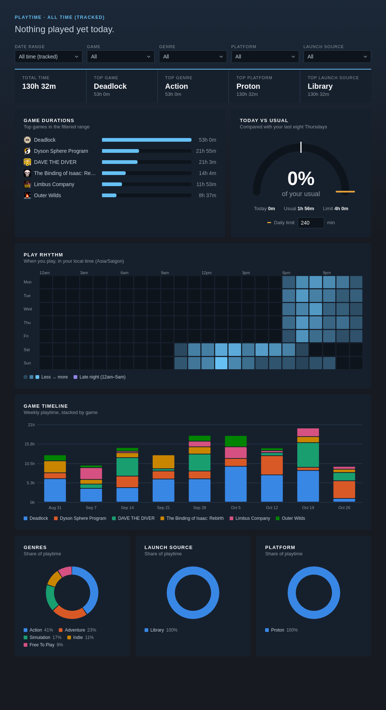

<div align="center">

# Playtime Dashboard

A [Millennium](https://steambrew.app) plugin that logs every play session and turns it into a full-page dashboard, right inside the Steam client.




</div>

## What you get

| | |
|---|---|
| **Today at a glance** | A headline with time played, top games and platform |
| **Stat cards** | Total time, top game, genre, platform and launch source |
| **Game durations** | Your games as ranked bars |
| **Today vs usual** | A gauge comparing today with your last eight matching weekdays |
| **Play rhythm** | Weekday × hour heatmap in local time, late-night hours tinted |
| **Game timeline** | Weekly stacked bars, one colour per game |
| **Breakdowns** | Donut charts for genre, launch source and platform |
| **Filters** | Date range, game, genre, platform, launch source |
| **Daily limit** | Optional. Marker on the gauge, toast at 80% and 100% (once each per day). It only notifies, it never closes a game. |

## Install

Requires **Millennium ≥ 3.4.0** and [**Bun**](https://bun.com).

```bash
bun install
bun run build
```

The build installs the plugin into Millennium. Then:

1. Enable **Playtime Dashboard** in Millennium settings
2. Reload Steam
3. Open the plugin's panel and click **Open dashboard**

## How tracking works

**Sessions**

- Start and stop come from Steam's app lifetime events. The launch source comes from Steam's game-action events.
- A heartbeat is saved every minute while a game runs. If Steam crashes, the PC sleeps, or a heartbeat is more than 3 minutes old, the session closes at its last heartbeat.
- Sessions that cross local midnight are split across both days.
- Two games at once: total time counts the overlap once, per-game durations count each game in full.

**Genres**

- Looked up once per game from the Steam store, then cached. Games with no genre yet (including imported ones) are looked up in the background.

**Date ranges**

| Range | Source |
|---|---|
| Any normal range | The plugin's session log, like WakaTime |
| All time (tracked) | Only the plugin's log, so it starts at install |
| All time (Steam) | Per game, the larger of Steam's lifetime counter and the log, so play from before install still counts. A platform or launch source filter turns this off, since Steam doesn't record those. |

## Your data

Stored in `~/.config/millennium/steam-playtime-dashboard/` on Linux, and in Millennium's install folder elsewhere.

| File | Contents |
|---|---|
| `sessions.jsonl` | One finished session per line, append-only. A corrupt line is skipped, not fatal. |
| `state.json` | Running sessions, genre cache, daily limit. Rewritten atomically while a game runs. |

The plugin's panel has two buttons:

- **Export data** writes `playtime-YYYY-MM-DD.jsonl` to a folder you pick.
- **Import data** merges sessions from an export or an old `playtime.json`. Duplicates are skipped, nothing is deleted.


## Limitations

- Non-Steam shortcuts are not tracked: Steam reports them as app ID 0.
- Platform is your OS, or **Proton** when the game uses a compatibility tool.
- Genre shows as **Unknown** until a store lookup succeeds. Some apps never return one.

## Development

```bash
bun run dev        # watch and hot-reload into Steam
bun test           # session log, storage parsing, stats
bun run typecheck
```

## License

[MIT](LICENSE)
